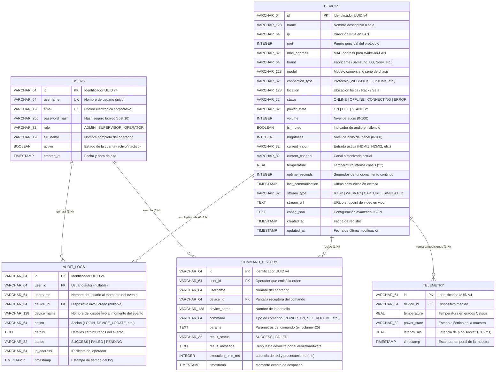
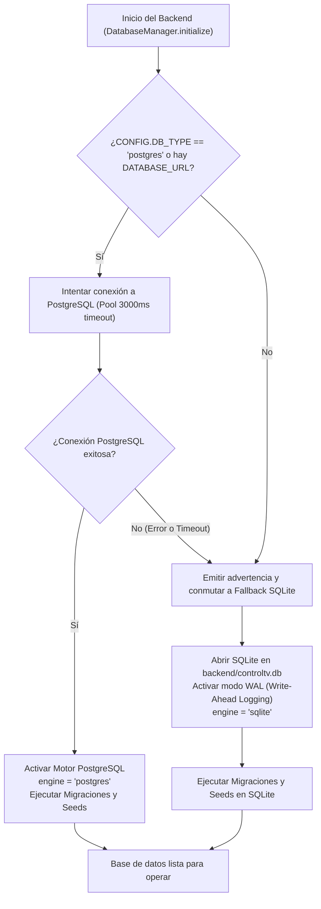
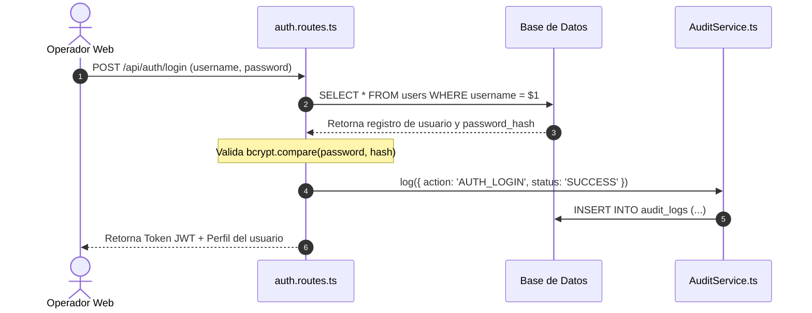
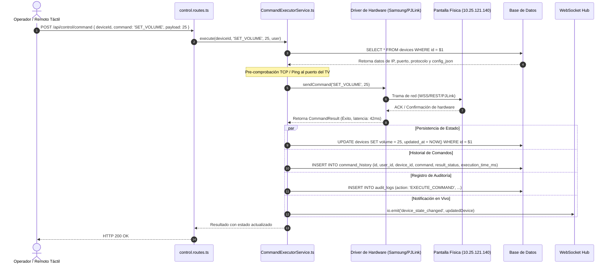
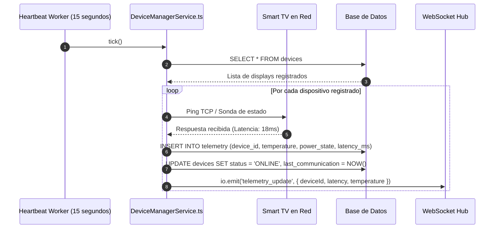

# Modelo Entidad-Relación (E-R) y Especificación de Base de Datos
## ControlTV NOC - Industrial Smart TV & Digital Signage Management

---

## 1. Introducción y Propósito

El presente documento describe en detalle el **Modelo Entidad-Relación (ER)**, el diseño de tablas, la arquitectura de persistencia y el funcionamiento integral de la base de datos para la plataforma **ControlTV NOC**.

ControlTV es un centro de operaciones de red (NOC) diseñado para monitorear, auditar y controlar en tiempo real un parque heterogéneo de pantallas Smart TV (Samsung Tizen, LG webOS, Sony BRAVIA) y displays de Digital Signage mediante protocolos industriales sobre IP (PJLink, Samsung MDC, Telnet, SNMP, REST API y Wake-on-LAN).

La base de datos tiene los siguientes propósitos fundamentales:
1. **Gestión de Identidad y Control de Acceso (RBAC):** Autenticación de operadores, supervisores y administradores.
2. **Inventario y Estado de Hardware en Vivo:** Registro técnico de cada televisor (IP, MAC, fabricante, modelo, protocolo de red, puertos de escucha, configuraciones de enlace) y su estado operacional reactivo (encendido, volumen, entrada HDMI activa, temperatura del chasis, tiempo en línea).
3. **Trazabilidad y Cumplimiento Normativo (Auditoría):** Registro inmutable de cada acción realizada por los usuarios dentro de la plataforma NOC.
4. **Historial de Comandos y Telemetría de Red:** Registro de cada orden enviada a los televisores, tiempos de respuesta (latencia en ms) y resultado de ejecución.
5. **Series Temporales de Telemetría:** Muestreos periódicos de variables físicas y de red para alimentar gráficos analíticos en tiempo real.

---

## 2. Diagrama Entidad-Relación (ERD)

A continuación se presenta el diagrama Entidad-Relación en notación Crow's Foot:



---

## 3. Relaciones y Cardinalidades

| Relación | Cardinalidad | Clave Foránea | Regla de Integridad Referencial | Descripción |
| :--- | :---: | :--- | :--- | :--- |
| `USERS` $\rightarrow$ `AUDIT_LOGS` | `1 : 0..N` | `audit_logs.user_id` $\rightarrow$ `users.id` | `ON DELETE SET NULL` | Un usuario puede generar múltiples registros de auditoría durante su sesión. Si el usuario se elimina, el log histórico se preserva con el campo desvinculado manteniendo el `username` como instantánea. |
| `USERS` $\rightarrow$ `COMMAND_HISTORY` | `1 : 0..N` | `command_history.user_id` $\rightarrow$ `users.id` | `ON DELETE SET NULL` | Un operador puede emitir muchas instrucciones de control remoto. Si se elimina la cuenta, el registro histórico se preserva intacto para auditoría interna. |
| `DEVICES` $\rightarrow$ `COMMAND_HISTORY` | `1 : 0..N` | `command_history.device_id` $\rightarrow$ `devices.id` | `ON DELETE CASCADE` | Cada comando se envía a una pantalla específica. Permite analizar el historial de órdenes por televisor. |
| `DEVICES` $\rightarrow$ `AUDIT_LOGS` | `0..1 : 0..N` | `audit_logs.device_id` $\rightarrow$ `devices.id` | `ON DELETE SET NULL` | Eventos administrativos sobre pantallas (alta, modificación de IP, cambio de driver). Si la acción fue de sistema o login, `device_id` es nulo. |
| `DEVICES` $\rightarrow$ `TELEMETRY` | `1 : 0..N` | `telemetry.device_id` $\rightarrow$ `devices.id` | `ON DELETE CASCADE` | Cada dispositivo genera una serie temporal continua de mediciones de temperatura y latencia para las gráficas de monitoreo. |

---

## 4. Diccionario de Datos Exhaustivo

### 4.1 Tabla: `users`
Almacena los usuarios autorizados para ingresar a la plataforma NOC con autenticación JWT y roles RBAC.

| Campo | Tipo SQL | TypeScript | Nulo | Por Defecto | Descripción |
| :--- | :--- | :--- | :---: | :---: | :--- |
| `id` | VARCHAR(64) | `string` | **NO** | *None* | Identificador primario UUID v4 único. |
| `username` | VARCHAR(64) | `string` | **NO** | *None* | Nombre de usuario único para inicio de sesión en la consola. |
| `email` | VARCHAR(128) | `string` | **NO** | *None* | Dirección de correo electrónico corporativo única. |
| `password_hash` | VARCHAR(256) | `string` | **NO** | *None* | Hash criptográfico bcrypt con salt de 10 rondas. |
| `role` | VARCHAR(32) | `UserRole` | **NO** | `'OPERATOR'` | Nivel de permisos: `ADMIN`, `SUPERVISOR`, `OPERATOR`. |
| `full_name` | VARCHAR(128) | `string` | **NO** | *None* | Nombre completo del operador o técnico de red. |
| `active` | BOOLEAN | `boolean` | **NO** | `TRUE` | Bandera lógica de habilitación para acceso. |
| `created_at` | TIMESTAMP | `string` | **NO** | `CURRENT_TIMESTAMP` | Fecha y hora de creación de la cuenta. |

*Restricciones e Índices:*
- Primary Key: `id`
- Unique: `username`, `email`

---

### 4.2 Tabla: `devices`
Representa el inventario de pantallas físicas Smart TV y paneles Digital Signage, manteniendo su configuración de red y su estado operacional en vivo (Digital Twin).

| Campo | Tipo SQL | TypeScript | Nulo | Por Defecto | Descripción |
| :--- | :--- | :--- | :---: | :---: | :--- |
| `id` | VARCHAR(64) | `string` | **NO** | *None* | Identificador primario UUID v4 único. |
| `name` | VARCHAR(128) | `string` | **NO** | *None* | Nombre legible (ej: *Samsung Smart TV 50" NOC Monitoreo*). |
| `ip` | VARCHAR(64) | `string` | **NO** | *None* | Dirección IPv4 estática o reservada en la red local. |
| `port` | INTEGER | `number` | **NO** | *None* | Puerto TCP/UDP principal para el driver seleccionado. |
| `mac_address` | VARCHAR(32) | `string?` | SÍ | `NULL` | Dirección MAC física para paquetes mágicos Wake-on-LAN (WoL). |
| `brand` | VARCHAR(64) | `string` | **NO** | *None* | Marca del televisor: *Samsung*, *LG*, *Sony*, *Panasonic*, etc. |
| `model` | VARCHAR(128) | `string` | **NO** | *None* | Modelo de chasis comercial o serie de firmware. |
| `connection_type` | VARCHAR(32) | `ConnectionType`| **NO** | *None* | Protocolo: `WEBSOCKET`, `PJLINK`, `REST_API`, `TELNET`, `SNMP`, `VIRTUAL`. |
| `location` | VARCHAR(128) | `string?` | SÍ | `NULL` | Ubicación física (ej: *Sala de Control Principal NOC*, *Piso 2*). |
| `status` | VARCHAR(32) | `DeviceStatus` | **NO** | `'OFFLINE'` | Conectividad de red: `ONLINE`, `OFFLINE`, `CONNECTING`, `ERROR`. |
| `power_state` | VARCHAR(32) | `PowerState` | **NO** | `'STANDBY'` | Estado de alimentación: `ON`, `OFF`, `STANDBY`. |
| `volume` | INTEGER | `number` | **NO** | `20` | Nivel de audio maestro (escala entera 0 a 100). |
| `is_muted` | BOOLEAN | `boolean` | **NO** | `FALSE` | Silenciamiento del canal de audio. |
| `brightness` | INTEGER | `number` | **NO** | `80` | Nivel de brillo de la retroiluminación del panel (0 a 100). |
| `current_input` | VARCHAR(32) | `InputSource` | **NO** | `'HDMI1'` | Fuente activa: `HDMI1`, `HDMI2`, `HDMI3`, `DISPLAYPORT`, `USB`, `TV`, `PC`. |
| `current_channel` | VARCHAR(32) | `string?` | SÍ | `NULL` | Identificador de canal sintonizado en modo TV. |
| `temperature` | REAL | `number?` | SÍ | `34.5` | Temperatura interna del panel en grados Celsius (°C). |
| `uptime_seconds` | INTEGER | `number?` | SÍ | `0` | Tiempo de actividad continuo en segundos. |
| `last_communication`| TIMESTAMP | `string?` | SÍ | `NULL` | Estampa temporal del último intercambio de paquetes exitoso. |
| `stream_type` | VARCHAR(32) | `ScreenStreamType`| **NO** | `'NONE'` | Modo de visualización: `RTSP`, `WEBRTC`, `SCREEN_CAPTURE`, `SIMULATED`. |
| `stream_url` | TEXT | `string?` | SÍ | `NULL` | URI RTSP, endpoint HTTP o WebSocket de captura de pantalla. |
| `config_json` | TEXT | `string?` | SÍ | `NULL` | Objeto JSON con configuración avanzada (credenciales, puertos, tokens). |
| `created_at` | TIMESTAMP | `string` | **NO** | `CURRENT_TIMESTAMP` | Fecha de creación del registro. |
| `updated_at` | TIMESTAMP | `string` | **NO** | `CURRENT_TIMESTAMP` | Fecha de última actualización de estado o configuración. |

*Restricciones e Índices:*
- Primary Key: `id`
- Index: `idx_devices_ip` sobre la columna `ip` (agiliza búsquedas durante escaneos de red y validaciones de ping).

---

### 4.3 Tabla: `command_history`
Registra el historial de comandos remotos emitidos desde la consola hacia los dispositivos físicos, almacenando tiempos de ejecución y respuestas.

| Campo | Tipo SQL | TypeScript | Nulo | Por Defecto | Descripción |
| :--- | :--- | :--- | :---: | :---: | :--- |
| `id` | VARCHAR(64) | `string` | **NO** | *None* | Identificador UUID v4 único de la transacción. |
| `user_id` | VARCHAR(64) | `string?` | SÍ | `NULL` | ID del usuario autenticado que ejecutó la orden. |
| `username` | VARCHAR(64) | `string` | **NO** | *None* | Nombre del usuario que ejecutó la orden (snapshot). |
| `device_id` | VARCHAR(64) | `string` | **NO** | *None* | Clave foránea que referencia al televisor receptor. |
| `device_name` | VARCHAR(128) | `string` | **NO** | *None* | Nombre de la pantalla al momento del comando. |
| `command` | VARCHAR(64) | `CommandType` | **NO** | *None* | Código de comando: `POWER_ON`, `POWER_OFF`, `SET_VOLUME`, `KEY_PRESS`, etc. |
| `params` | TEXT | `string?` | SÍ | `NULL` | Parámetros adicionales en formato string o JSON (ej: `{"key":"KEY_ENTER"}`). |
| `result_status` | VARCHAR(32) | `string` | **NO** | *None* | Resultado devuelto por el driver: `SUCCESS` o `FAILED`. |
| `result_message` | TEXT | `string?` | SÍ | `NULL` | Mensaje descriptivo o respuesta cruda del hardware. |
| `execution_time_ms`| INTEGER | `number` | **NO** | `0` | Tiempo de ida y vuelta de red (RTT) y ejecución en milisegundos. |
| `timestamp` | TIMESTAMP | `string` | **NO** | `CURRENT_TIMESTAMP` | Momento exacto del despacho del comando. |

*Restricciones e Índices:*
- Primary Key: `id`
- Foreign Key: `device_id` $\rightarrow$ `devices(id)`
- Index: `idx_command_device` sobre la columna `device_id` (para cargar el historial rápido de un display específico).

---

### 4.4 Tabla: `audit_logs`
Almacena un registro de auditoría inmutable para garantizar cumplimiento de seguridad informática y auditorías forenses del NOC.

| Campo | Tipo SQL | TypeScript | Nulo | Por Defecto | Descripción |
| :--- | :--- | :--- | :---: | :---: | :--- |
| `id` | VARCHAR(64) | `string` | **NO** | *None* | Identificador UUID v4 de la entrada de auditoría. |
| `user_id` | VARCHAR(64) | `string?` | SÍ | `NULL` | ID del usuario asociado a la acción. |
| `username` | VARCHAR(64) | `string` | **NO** | *None* | Nombre de usuario o `'SYSTEM'` para procesos internos. |
| `device_id` | VARCHAR(64) | `string?` | SÍ | `NULL` | ID del televisor si la acción afectó a un dispositivo físico. |
| `device_name` | VARCHAR(128) | `string?` | SÍ | `NULL` | Nombre del televisor afectado (si aplica). |
| `action` | VARCHAR(64) | `string` | **NO** | *None* | Código de acción: `AUTH_LOGIN`, `DEVICE_CREATE`, `DEVICE_UPDATE`, etc. |
| `details` | TEXT | `string?` | SÍ | `NULL` | Detalles explicativos o volcado de cambios en JSON. |
| `status` | VARCHAR(32) | `string` | **NO** | `'SUCCESS'` | Estado de la operación: `SUCCESS`, `FAILED`, `PENDING`. |
| `ip_address` | VARCHAR(64) | `string?` | SÍ | `NULL` | Dirección IP desde donde se originó la petición web. |
| `timestamp` | TIMESTAMP | `string` | **NO** | `CURRENT_TIMESTAMP` | Fecha y hora exacta del registro del evento. |

*Restricciones e Índices:*
- Primary Key: `id`
- Index: `idx_audit_timestamp` sobre la columna `timestamp` DESC (permite paginación eficiente de los eventos más recientes).

---

### 4.5 Tabla: `telemetry`
Almacena mediciones de series temporales generadas periódicamente por el servicio de Heartbeat (cada 15 segundos) para graficar estabilidad térmica y latencia de red en Recharts.

| Campo | Tipo SQL | TypeScript | Nulo | Por Defecto | Descripción |
| :--- | :--- | :--- | :---: | :---: | :--- |
| `id` | VARCHAR(64) | `string` | **NO** | *None* | Identificador UUID v4 único de la muestra. |
| `device_id` | VARCHAR(64) | `string` | **NO** | *None* | Identificador del dispositivo evaluado. |
| `temperature` | REAL | `number?` | SÍ | `NULL` | Lectura de temperatura del procesador/panel en °C. |
| `power_state` | VARCHAR(32) | `PowerState?`| SÍ | `NULL` | Estado de encendido durante el muestreo. |
| `latency_ms` | REAL | `number?` | SÍ | `NULL` | Latencia de comunicación TCP en milisegundos. |
| `timestamp` | TIMESTAMP | `string` | **NO** | `CURRENT_TIMESTAMP` | Momento exacto de captura de la métrica. |

*Restricciones e Índices:*
- Primary Key: `id`
- Foreign Key: `device_id` $\rightarrow$ `devices(id)`
- Index compuesto: `idx_telemetry_device` sobre `(device_id, timestamp)` para optimizar consultas de series de tiempo de una pantalla dentro de una ventana de tiempo.

---

## 5. Estructura JSON Semiestructurada (`config_json`)

Para soportar la diversidad de protocolos de hardware sin requerir cambios continuos de esquema relacional (schema migrations), la tabla `devices` incluye el campo `config_json`.

### Esquema y Ejemplo para Samsung Smart TV (Tizen OS):
```json
{
  "subnetMask": "255.255.255.0",
  "gateway": "10.25.121.239",
  "dns": "10.25.121.239",
  "macAddress": "80:8a:bd:13:28:8a",
  "modelCode": "UN5073CVT403309Z",
  "token": "13423728",
  "duid": "uuid:c636c6ba-c590-48f3-b6ce-45494333ce34",
  "authCredentials": {
    "token": "13423728"
  },
  "testedPorts": {
    "80": { "open": false, "service": "HTTP" },
    "443": { "open": false, "service": "HTTPS" },
    "22": { "open": false, "service": "SSH" },
    "161": { "open": false, "service": "SNMP" },
    "1900": { "open": true, "service": "SSDP / UPnP" },
    "8001": { "open": true, "service": "Samsung Tizen REST API" },
    "8002": { "open": true, "service": "Samsung Smart Remote WSS" },
    "4352": { "open": false, "service": "PJLink" }
  },
  "customPorts": {
    "tizenRest": 8001,
    "tizenWss": 8002,
    "pjlink": 4352
  }
}
```

---

## 6. Arquitectura y Funcionamiento del Motor de Base de Datos

### 6.1 Motor Dual Híbrido (Dual-Engine Persistency)
El archivo `backend/src/db/index.ts` implementa la clase `DatabaseManager` con estrategia de resiliencia y auto-fallback:



1. **PostgreSQL 16 (Entorno de Producción):** Ideal para despliegues empresariales con Docker Compose o clústeres donde múltiples nodos backend atienden peticiones concurrentes.
2. **SQLite con WAL (Zero-Config Development):** Permite clonar el repositorio y ejecutar el proyecto instantáneamente en cualquier computadora sin necesidad de instalar servicios externos. El modo WAL (*Write-Ahead Logging*) asegura alta concurrencia de lectura y escritura sin bloqueos de tabla.
3. **Capa de Abstracción de Parámetros:** La función `db.query(sql, params)` convierte automáticamente la sintaxis de variables de enlace de PostgreSQL (`$1, $2, $3`) a signos de interrogación de SQLite (`?`) y mapea booleanos (`true/false` $\rightarrow$ `1/0`) de forma transparente para los servicios de negocio.

---

## 7. Flujos Operativos de la Base de Datos

### Flujo 1: Inicio de Sesión y Auditoría


### Flujo 2: Despacho de Comandos y Telemetría


### Flujo 3: Muestreo Periódico de Heartbeat y Telemetría


---

## 8. Script SQL DDL de Creación de Tablas e Índices

El siguiente script es compatible tanto con **PostgreSQL 12+** como con **SQLite 3.30+**:

```sql
-- ============================================================================
-- ControlTV Industrial Smart TV & Digital Signage Database Schema
-- Compatible con PostgreSQL 12+ y SQLite (modo WAL)
-- ============================================================================

-- 1. Tabla de Usuarios y Operadores
CREATE TABLE IF NOT EXISTS users (
    id VARCHAR(64) PRIMARY KEY,
    username VARCHAR(64) UNIQUE NOT NULL,
    email VARCHAR(128) UNIQUE NOT NULL,
    password_hash VARCHAR(256) NOT NULL,
    role VARCHAR(32) NOT NULL DEFAULT 'OPERATOR',
    full_name VARCHAR(128) NOT NULL,
    active BOOLEAN NOT NULL DEFAULT TRUE,
    created_at TIMESTAMP DEFAULT CURRENT_TIMESTAMP
);

-- 2. Tabla de Inventario de Pantallas y Displays
CREATE TABLE IF NOT EXISTS devices (
    id VARCHAR(64) PRIMARY KEY,
    name VARCHAR(128) NOT NULL,
    ip VARCHAR(64) NOT NULL,
    port INTEGER NOT NULL,
    mac_address VARCHAR(32),
    brand VARCHAR(64) NOT NULL,
    model VARCHAR(128) NOT NULL,
    connection_type VARCHAR(32) NOT NULL,
    location VARCHAR(128),
    status VARCHAR(32) NOT NULL DEFAULT 'OFFLINE',
    power_state VARCHAR(32) NOT NULL DEFAULT 'STANDBY',
    volume INTEGER NOT NULL DEFAULT 20,
    is_muted BOOLEAN NOT NULL DEFAULT FALSE,
    brightness INTEGER NOT NULL DEFAULT 80,
    current_input VARCHAR(32) NOT NULL DEFAULT 'HDMI1',
    current_channel VARCHAR(32),
    temperature REAL DEFAULT 34.5,
    uptime_seconds INTEGER DEFAULT 0,
    last_communication TIMESTAMP,
    stream_type VARCHAR(32) NOT NULL DEFAULT 'NONE',
    stream_url TEXT,
    config_json TEXT,
    created_at TIMESTAMP DEFAULT CURRENT_TIMESTAMP,
    updated_at TIMESTAMP DEFAULT CURRENT_TIMESTAMP
);

-- 3. Tabla de Bitácora de Auditoría
CREATE TABLE IF NOT EXISTS audit_logs (
    id VARCHAR(64) PRIMARY KEY,
    user_id VARCHAR(64),
    username VARCHAR(64) NOT NULL,
    device_id VARCHAR(64),
    device_name VARCHAR(128),
    action VARCHAR(64) NOT NULL,
    details TEXT,
    status VARCHAR(32) NOT NULL DEFAULT 'SUCCESS',
    ip_address VARCHAR(64),
    timestamp TIMESTAMP DEFAULT CURRENT_TIMESTAMP
);

-- 4. Tabla de Historial de Comandos de Red
CREATE TABLE IF NOT EXISTS command_history (
    id VARCHAR(64) PRIMARY KEY,
    user_id VARCHAR(64),
    username VARCHAR(64) NOT NULL,
    device_id VARCHAR(64) NOT NULL,
    device_name VARCHAR(128) NOT NULL,
    command VARCHAR(64) NOT NULL,
    params TEXT,
    result_status VARCHAR(32) NOT NULL,
    result_message TEXT,
    execution_time_ms INTEGER NOT NULL DEFAULT 0,
    timestamp TIMESTAMP DEFAULT CURRENT_TIMESTAMP
);

-- 5. Tabla de Series Temporales de Telemetría
CREATE TABLE IF NOT EXISTS telemetry (
    id VARCHAR(64) PRIMARY KEY,
    device_id VARCHAR(64) NOT NULL,
    temperature REAL,
    power_state VARCHAR(32),
    latency_ms REAL,
    timestamp TIMESTAMP DEFAULT CURRENT_TIMESTAMP
);

-- Índices de Rendimiento y Acceso Rápido
CREATE INDEX IF NOT EXISTS idx_devices_ip ON devices(ip);
CREATE INDEX IF NOT EXISTS idx_audit_timestamp ON audit_logs(timestamp);
CREATE INDEX IF NOT EXISTS idx_command_device ON command_history(device_id);
CREATE INDEX IF NOT EXISTS idx_telemetry_device ON telemetry(device_id, timestamp);
```

---

## 9. Datos Semilla por Defecto (Seed Defaults)

Al inicializar la base de datos por primera vez, el sistema inserta automáticamente las credenciales iniciales de acceso y el registro de la pantalla Samsung Smart TV configurada para pruebas físicas:

### Cuentas de Acceso por Defecto:
| Usuario | Contraseña | Rol | Correo |
| :--- | :--- | :--- | :--- |
| `admin` | `admin123` | `ADMIN` | `admin@controltv.lan` |
| `supervisor` | `super123` | `SUPERVISOR` | `supervisor@controltv.lan` |
| `operator` | `oper123` | `OPERATOR` | `operator@controltv.lan` |

### Dispositivo Físico Precargado:
- **Nombre:** `Samsung Smart TV 50" (NOC Monitoreo)`
- **IP:** `10.25.121.140`
- **Puerto:** `8001` (REST) / `8002` (WSS)
- **MAC:** `80:8a:bd:13:28:8a`
- **Fabricante/Modelo:** Samsung / UN5073CVT403309Z
- **Protocolo de Enlace:** `WEBSOCKET` (Samsung Smart Remote WSS con Token `13423728`)
- **Ubicación:** Sala de Control Principal NOC
