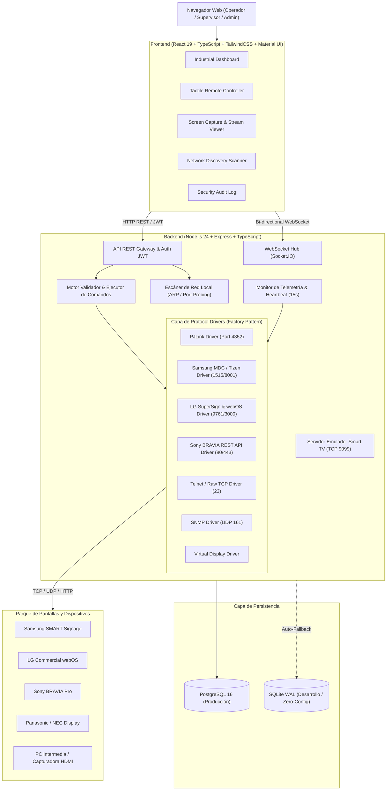

# Arquitectura del Sistema - ControlTV NOC

## 1. Visión General del Sistema
**ControlTV** es una plataforma de software de grado empresarial diseñada para la monitorización, telemetría y control remoto centralizado de pantallas Smart TV y pantallas Digital Signage profesionales a través de redes IP (LAN/VLAN/WAN).

Está diseñada como un centro de operaciones de red (NOC / Monitoring Center) con soporte multiprotocolo heterogéneo (PJLink, Samsung MDC, LG SuperSign/webOS, Sony BRAVIA REST, Telnet, SNMP y Wake-on-LAN).

---

## 2. Capas de la Arquitectura

### 2.1 Capa de Presentación (Frontend)
- **Framework:** React 19 + TypeScript 5.
- **Estilos:** Tailwind CSS v4 + variables CSS para tema oscuro industrial (#0b0f19) + Material UI.
- **Gráficos en tiempo real:** Recharts (Series temporales de temperatura interna del chasis y latencia de ping).
- **Comunicación en vivo:** Socket.IO Client para actualización instantánea de estados sin recargar página.
- **Captura de Pantalla:** Web Screen Capture API (`navigator.mediaDevices.getDisplayMedia`) para interconectar PCs intermedias o capturadoras de video HDMI-USB.

### 2.2 Capa de Negocio y Control (Backend)
- **Runtime:** Node.js v24 LTS + Express.
- **Seguridad:** Helmet, CORS restrictivo, autenticación Bearer JWT con RBAC (Control de Acceso Basado en Roles).
- **Validación previa obligatoria:** Antes de emitir cualquier comando remoto (salvo WoL), el sistema comprueba la conectividad TCP activa en menos de 2500ms. Si la pantalla no responde, el comando se aborta para prevenir cuelgues y se marca OFFLINE.
- **Patrón Factory para Drivers:** `DriverFactory.getDriver(device)` desacopla el modelo de datos de la lógica de red binaria de cada fabricante.

### 2.3 Capa de Protocolos de Red (Hardware Drivers)
1. **PJLink (JBMIA Class 1 & 2):** Puerto TCP 4352. Control estándar de encendido (`%1POWR 1`), apagado (`%1POWR 0`), entradas (`%1INPT 31`), y mute (`%1AVMT 21`).
2. **Samsung MDC (Multiple Display Control):** Protocolo serie sobre Ethernet (Puerto 1515/8080). Trama binaria `0xAA` + Código de Comando + ID + Longitud + Datos + Checksum módulo 256.
3. **LG SuperSign / webOS Commercial:** Puerto 9761 / 23. Sintaxis ASCII serial `ka 01 01\r` (Encendido), `xb 01 90\r` (HDMI1), `kf 01 [vol]\r`.
4. **Sony BRAVIA Professional:** REST API JSON-RPC contra `/sony/system`, `/sony/audio`, `/sony/avContent` usando clave precompartida `X-Auth-PSK`.
5. **Telnet / Socket TCP Genérico:** Enlaces de streaming ASCII bidireccionales con terminadores `\r\n`.
6. **Wake-on-LAN (WoL):** Tramas mágicas UDP (puerto 9) emitidas a la dirección MAC física para despertar pantallas en modo reposo profundo.
7. **Virtual Interactive Driver:** Simulador de pantalla de alta fidelidad que replica deriva térmica, cambios de canal, volumen y respuesta instantánea para laboratorio o demostraciones.

### 2.4 Capa de Datos (Dual-Engine Persistency)
- **PostgreSQL 16:** Motor primario relacional para despliegues de producción y clústeres.
- **SQLite WAL:** Mecanismo integrado de cero configuración. Si PostgreSQL no está activo o configurado en la máquina anfitriona, el backend conmuta instantáneamente a SQLite sin lanzar excepciones de inicio.
