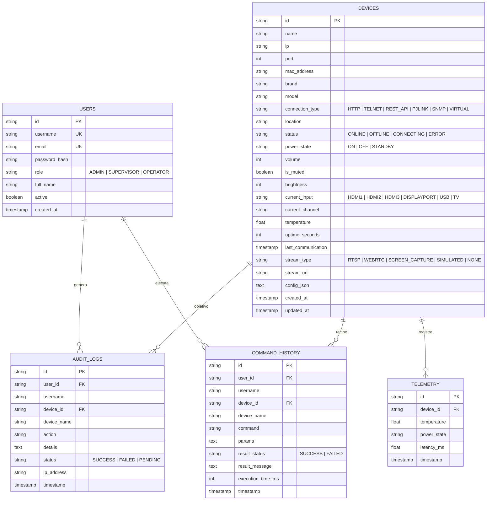

# Modelo de Base de Datos - ControlTV

## 1. Diagrama Entidad-Relación (ERD)

---

## 2. Diccionario de Datos

### 2.1 Tabla `users`
Almacena las cuentas de usuario autorizadas para ingresar a la consola NOC.
| Columna | Tipo | Nulo | Descripción |
| :--- | :--- | :---: | :--- |
| `id` | VARCHAR(64) | No | Identificador UUID v4 único |
| `username` | VARCHAR(64) | No | Nombre de usuario único para autenticación |
| `email` | VARCHAR(128) | No | Correo electrónico corporativo |
| `password_hash` | VARCHAR(256) | No | Hash seguro de la contraseña (bcrypt, 10 rounds) |
| `role` | VARCHAR(32) | No | Rol RBAC: `ADMIN`, `SUPERVISOR`, `OPERATOR` |
| `full_name` | VARCHAR(128) | No | Nombre y apellidos del operador |
| `active` | BOOLEAN | No | Estado de activación de la cuenta |
| `created_at` | TIMESTAMP | No | Fecha y hora de creación de la cuenta |

### 2.2 Tabla `devices`
Registra el inventario de pantallas Smart TV y displays Digital Signage.
| Columna | Tipo | Nulo | Descripción |
| :--- | :--- | :---: | :--- |
| `id` | VARCHAR(64) | No | Identificador UUID v4 |
| `name` | VARCHAR(128) | No | Nombre descriptivo del display o sala |
| `ip` | VARCHAR(64) | No | Dirección IPv4 de la pantalla en la red LAN |
| `port` | INTEGER | No | Puerto de escucha del protocolo de control |
| `mac_address` | VARCHAR(32) | Sí | Dirección MAC para paquetes Wake-on-LAN |
| `brand` | VARCHAR(64) | No | Fabricante: Samsung, LG, Sony, Panasonic, etc. |
| `model` | VARCHAR(128) | No | Modelo comercial o serie |
| `connection_type`| VARCHAR(32) | No | Protocolo: PJLINK, TELNET, REST_API, HTTP, SNMP, VIRTUAL |
| `location` | VARCHAR(128) | Sí | Ubicación física (Ej: Sala de Crisis Piso 4) |
| `status` | VARCHAR(32) | No | Estado de conectividad: ONLINE, OFFLINE |
| `power_state` | VARCHAR(32) | No | Estado eléctrico: ON, OFF, STANDBY |
| `volume` | INTEGER | No | Nivel de audio (0 a 100) |
| `is_muted` | BOOLEAN | No | Indicador de silencio activo |
| `brightness` | INTEGER | No | Brillo del panel (0 a 100) |
| `current_input`| VARCHAR(32) | No | Entrada activa: HDMI1, HDMI2, HDMI3, DISPLAYPORT, USB |
| `temperature` | REAL | Sí | Temperatura del chasis en grados Celsius |
| `stream_type` | VARCHAR(32) | No | Tipo de vista remota: RTSP, WEBRTC, SCREEN_CAPTURE, SIMULATED |
| `config_json` | TEXT | Sí | Configuración extendida (credenciales, puertos auxiliares) |

### 2.3 Tabla `audit_logs`
Registro inmutable de auditoría para cumplimiento normativo (quién hizo qué y cuándo).

### 2.4 Tabla `command_history`
Historial de telemetría de red y tiempos de respuesta de cada instrucción enviada.

### 2.5 Tabla `telemetry`
Series temporales registradas periódicamente por el monitor de fondo (heartbeat) para alimentar los gráficos de estabilidad térmica y latencia de red.
