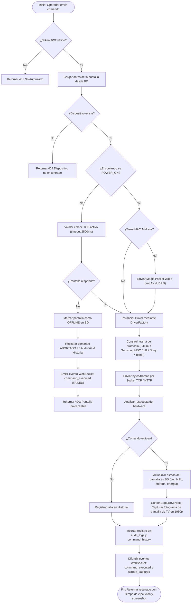
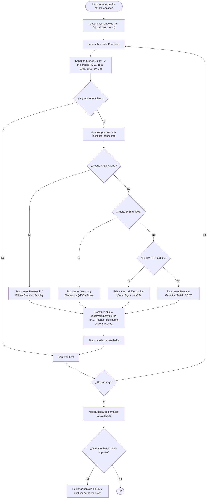
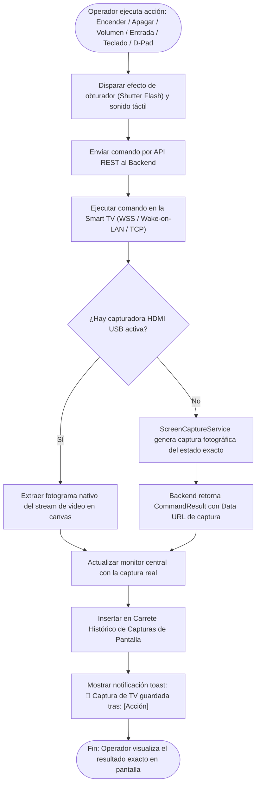

# Diagramas de Flujo del Sistema - ControlTV

## 1. Flujo de Ejecución de Comandos con Validación Previa de Conectividad

Este diagrama modela el cumplimiento estricto del **Requisito 3**: *"Validar conectividad antes de enviar comandos"*, junto con el registro de auditoría e historial de comandos.

---

## 2. Flujo de Descubrimiento Automático en Red Local (Network Discovery)

Este flujo modela el **Requisito 6**: Detección de dispositivos compatibles por escaneo de puertos clave y fingerprinting.

---

## 3. Flujo de Captura Automática de Pantalla de Televisión tras Acción Remota

Este flujo modela la toma y despliegue de **capturas reales de pantalla de la televisión tras cada acción del control remoto**:

